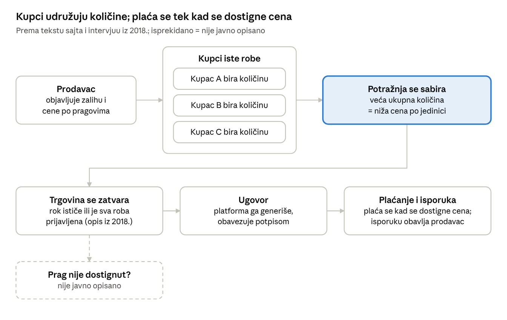

# eBerza — Product Research & Video Brief

16. 10. 2026. · FAZA 1 — Istraživanje

> Snimak dokumenta. Živa verzija (za komentare i odgovore): https://claude.ai/code/artifact/d7b768d7-c26e-42ce-9c6d-ac541cd4980b

## Sažetak i metod istraživanja

eBerza je B2B platforma za udruženu (grupnu) kupovinu: prodavac nudi cenu koja pada sa ukupnom količinom, a kupci se udružuju da zajedno stignu do nižeg praga. Osnovni model je jasan i dobro se objašnjava videom, ali nekoliko ključnih pravila (rok trgovine, šta ako se prag ne dostigne, provizije) nije javno potvrđeno.

**Važno ograničenje:** sajt eberza.rs i YouTube nisu mogli da se otvore iz ovog radnog okruženja. Mrežna politika okruženja dozvoljava samo GitHub i package managere. Zato sajt nisam pregledao vizuelno, niti sam video izgled ekrana, logo, boje i fontove.

Nalazi ispod potiču iz web pretrage: tekstovi stranica eberza.rs koje je pretraživač indeksirao i medijski članci. Pretraga vraća automatski sažet tekst, pa citati sa sajta moraju da se uporede sa živim sajtom pre nego što uđu u naraciju.

| Izvor | Šta je dobijeno | Pouzdanost |
| --- | --- | --- |
| [eberza.rs/sr](https://eberza.rs/sr) (početna) | Opis platforme, navigacija: Kupci, Prodavci, Franšiza, Pravila, FAQ, Vesti; kontakt u footeru | Tekst sa sajta, posredno |
| [eberza.rs/sr/buyers](https://eberza.rs/sr/buyers) | Poruke za kupce, poziv „Pridružite se besplatno“; footer sa godinom 2020 | Tekst sa sajta, posredno |
| [eberza.rs/en/sellers](https://eberza.rs/en/sellers) | Poruke za prodavce (engleska verzija) | Tekst sa sajta, posredno; srpsku verziju treba uporediti |
| [eberza.rs/en/franchise](https://eberza.rs/en/franchise) | Tok grupne kupovine, ugovor, odgovornost za isporuku | Tekst sa sajta, posredno |
| [Danas, 2018](https://www.danas.rs/vesti/ekonomija/eberza-resenje-za-ulazak-srpskih-firmi-na-globalno-trziste/) | Mehanizam, primer sa peškirima, zatvaranje trgovine | Intervju sa osnivačima, star oko 8 godina |
| [Elektronsko bankarstvo, 27. 11. 2018.](https://www.elektronskobankarstvo.rs/e-berza-pomaze-srpskim-firmama-da-udju-na-globalno-trziste/) | Isti mehanizam, izjava jednog korisnika | Medij, star oko 8 godina |
| [International Franchise Expo 2024](https://www.franchiseexpo.com/ife/exhibitors/afeja-belgrade) | B2B model, franšizni model, operator AFEJA | Profil izlagača (samoopis) |
| [Facebook: „eBerza - pametna trgovina“](https://www.facebook.com/eberza.rs/) | Naziv stranice i slogan | Samo naslov stranice |

**Nije provereno:** pun tekst stranica Pravila i FAQ, izgled sajta i tok posle prijave, aktivne ponude, vizuelni identitet i oba referentna videa. Referentne snimke nisam pogledao (sekcija o referencama).

## 1. Šta je eBerza, jednostavno objašnjeno

eBerza je internet berza za firme na kojoj više kupaca zajedno kupuje istu robu, da bi svi dobili cenu koja inače važi samo za velike porudžbine.

Zvanični opis sa početne strane: „eberza je platforma koja povezuje kupce i prodavce, omogućavajući im da ostvare najpovoljnije cene kroz udruženu trgovinu i količinske popuste.“

- **Prodavac** postavlja ponudu sa količinskim popustom: što se ukupno kupi više, cena po jedinici je niža.
- **Kupac** bira količinu koja mu treba i pridružuje se drugim kupcima iste robe. Sa stranice za kupce: „Kada se skupi dovoljno zainteresovanih dobijate najbolju cenu.“
- **Plaćanje** ne ide odmah: roba se plaća tek kada se dostigne željena cena, a na kraju trgovine platforma generiše ugovor.

| Činjenica | Vrednost | Izvor |
| --- | --- | --- |
| Operator | „AFEJA“ d.o.o., Bulevar Oslobođenja 51, Beograd | Kontakt na sajtu |
| Kontakt | eberza@afeja.com, +381 69 664557 | Kontakt na sajtu |
| Pokrenuta | 2018. (predstavljena u medijima novembra 2018.) | Danas, Elektronsko bankarstvo |
| Model | B2B: kupci i prodavci su firme (proizvođači, veleprodaje, distributeri) | Profil na Franchise Expo |
| Širenje | Teritorijalne franšize: franšizant promoviše platformu lokalnim firmama i pomaže korisnicima | [eberza.rs/en/franchise](https://eberza.rs/en/franchise) |
| Jezici sajta | srpski (/sr) i engleski (/en) | URL-ovi stranica |

**Otvoreno pitanje:** profil izlagača kaže da je model B2B, ali sajt objavljuje i obrazac za odustanak potrošača od ugovora na daljinu („Službeni glasnik RS“ 21/2022). Treba potvrditi da li i fizička lica mogu da kupuju.

## 2. Kako platforma funkcioniše, korak po korak

Trgovina ima sedam koraka, od ponude do isporuke; koraci 5 i 7 opisani su samo u člancima iz 2018. i moraju se potvrditi. Oznake: **\[sajt\]** = tekst sa eberza.rs, **\[2018\]** = intervju u medijima, **\[?\]** = nije javno opisano.

1. **Registracija.** Stranica za kupce nudi poziv „Pridružite se besplatno“ i dugme „Registrujte se“. \[sajt\] Koji se podaci traže (PIB, matični broj, verifikacija firme) nije poznato. \[?\]
2. **Prodavac postavlja ponudu.** Oglašava celu zalihu i daje količinski popust „od–do“ po jedinici. Svaka količina ima svoju cenu: što se više robe kupi, cena je niža. \[sajt, 2018\] Popuste određuje prodavac, ne platforma. \[sajt\]
3. **Kupac bira robu, količinu i uslove.** „Svaki kupac bira željenu količinu i uslove.“ \[sajt\] Prema opisu iz 2018., kupac unosi željenu robu, količinu i cenu. \[2018\]
4. **Potražnja se sabira.** Drugi kupci iste robe rade isto, a njihove količine se objedinjuju. „Vi i drugi kupci možete se udružiti i zajedno naručiti veće količine, ostvarujući značajne popuste.“ \[sajt\]
5. **Trgovina se zatvara.** Prodaja se zaključuje kada istekne rok ponude ili kada se prijavi onoliko kupaca koliko ima robe; roba se otkupljuje po najnižoj dostignutoj ceni. \[2018\] Ko određuje rok i šta se dešava ako prag nije dostignut, nije opisano. \[?\]
6. **Ugovor.** Na kraju trgovine platforma generiše obrazac ugovora koji postaje pravno obavezujući potpisom. \[sajt\] Način potpisa (elektronski ili papirni) nije poznat. \[?\]
7. **Plaćanje i isporuka.** Roba se plaća tek kada se dostigne željena cena. \[sajt\] Plaćanje ne ide preko portala, već po dogovoru kupca i prodavca. \[2018\] Isporuka je na adresu kupca ili dogovorenu lokaciju, a odgovornost je prodavčeva. \[sajt\]

Osenčen korak, sabiranje potražnje, jeste srž poruke videa; isprekidani deo je pravilo koje izvori ne opisuju i koje klijent treba da potvrdi.

**Privatnost i poverenje:** kupci nastupaju pod korisničkim imenom, a identitet kupca zna samo prodavac čiju robu kupuje. \[2018\] Posle trgovine učesnici vide uslove kupovine i isporuke i kontakt druge strane. \[sajt\] Prodavac koji ne ispunjava obaveze može biti isključen sa platforme. \[2018\]

**Ilustracija iz medija (2018., nije stvarna aktuelna ponuda):** prodavac nudi 100 peškira po 300 dinara, ponuda važi oko mesec dana. Kupcu trebaju tri peškira, koja u maloprodaji koštaju po 1.000 dinara; na eBerzi plaća 900 dinara. Ostalih 97 peškira u istom periodu kupuju drugi kupci.

## 3. Glavne prednosti za kupce

Glavna korist za kupca: cena velike porudžbine bez obaveze da sam naruči celu količinu. Ostale prednosti ispod su potvrđene tekstom sajta ili intervjuom iz 2018.

| Prednost | Šta kaže izvor | Izvor |
| --- | --- | --- |
| Niža cena kroz udruživanje | „Vi i drugi kupci možete se udružiti i zajedno naručiti veće količine, ostvarujući značajne popuste.“ | Stranica za kupce |
| Kupuje koliko mu treba | Kupac uzima željenu količinu, a do cene stiže zajedno sa drugim kupcima iste robe | Danas, 2018. |
| Nema plaćanja unapred | Roba se plaća tek kada se dostigne željena cena; kupac nije obavezan da odmah plati | Stranica o franšizi; Danas, 2018. |
| Besplatno učlanjenje | „Pridružite se besplatno“ | Stranica za kupce |
| Pravna sigurnost | Na kraju trgovine generiše se ugovor, obavezujući potpisom | Stranica o franšizi |
| Jasni uslovi | Uslovi kupovine, isporuke i kontakt prodavca su poznati učesnicima | Stranica o franšizi |
| Diskrecija | Kupac nastupa pod korisničkim imenom; identitet zna samo prodavac | Danas, 2018. |

**Šta video ne sme da tvrdi bez potvrde:** procenat uštede, garanciju isporuke (platforma je ne garantuje), da je korišćenje potpuno besplatno (provizije nisu poznate) i da kupac uvek dobija najnižu cenu.

## 4. Glavne prednosti za prodavce

Glavna korist za prodavca: jedna ponuda doseže više kupaca odjednom i prodaje veću količinu, bilo da je u pitanju višak zaliha ili planirana proizvodnja. Pretraživač je vratio samo englesku verziju stranice za prodavce; srpski tekst (/sr/sellers) treba uzeti sa živog sajta.

| Prednost | Šta kaže izvor | Izvor |
| --- | --- | --- |
| Prodaja većih količina | „Whether you have excess inventory or are planning production, eBerza allows you to sell larger quantities of goods efficiently.“ | Stranica za prodavce (EN) |
| Kupci dolaze sami | „Buyers search for your products on their own and join together for larger orders.“ | Stranica za prodavce (EN) |
| Rast prodaje i dostupnosti | „As a seller, eBerza offers you a unique opportunity to increase the sales and availability of your products.“ | Stranica za prodavce (EN) |
| Prodavac upravlja cenom | Prodavac sam određuje količinske popuste i pragove | Stranica o franšizi |
| Rešava zalihe koje vezuju novac | Prodavci kroz „količinske popuste“ rešavaju problem plasmana postojećih zaliha | Danas, 2018. |
| Planiranje proizvodnje | Jedan proizvođač (Li-kom plus, Gročka) naveo je da mu portal olakšava planiranje proizvodnje | Elektronsko bankarstvo, 2018. |
| Ugovor po završetku | Platforma generiše ugovor; sporovi idu kroz ugovorni mehanizam | Stranica o franšizi |

**Tvrdnje sa sajta koje treba proveriti pre upotrebe:** prema sažetku pretrage, engleska stranica pominje brži obrt zaliha „bez dodatnog ulaganja u marketing“ i „bez dodatnih troškova za izlazak na međunarodna tržišta“. Tačne formulacije nisu potvrđene, pa ih video za sada ne koristi. Izjava korisnika iz 2018. može u video samo uz njegovu saglasnost i proveru da je i danas aktuelna.

**Obaveza prodavca koju video treba pošteno da pokaže:** isporuka je odgovornost prodavca.

## Ciljni korisnici, problemi i razlika od internet prodavnice

eBerza se obraća firmama na obe strane: onima koje imaju robu u većim količinama i onima koje bi da kupe povoljnije, a same nemaju obim za veleprodajnu cenu.

**Ciljni korisnici (prema izvorima):**

- **Prodavci:** proizvođači, veleprodaje i distributeri; posebno oni sa viškom zaliha ili planiranom proizvodnjom.
- **Kupci:** firme koje nabavljaju robu, od male firme do većeg lanca, prema poruci sa sajta (tačnu formulaciju treba preuzeti sa živog sajta).
- **Franšizanti:** partneri koji razvijaju mrežu na svojoj teritoriji; nisu publika ovog videa, osim ako se ne odluči drugačije.

**Problemi koje platforma rešava:**

- Mali kupac ne može sam da naruči količinu za koju važi najbolja cena.
- Prodavac ima zalihe koje vezuju novac i teško ih plasira kroz pojedinačne porudžbine. (Danas, 2018.)
- Domaće firme teško prelaze lokalnu i regionalnu izolovanost. (Danas, 2018.)

|  | Klasična internet prodavnica | eBerza |
| --- | --- | --- |
| Ko određuje cenu | Prodavnica, ista cena za sve | Prodavac daje pragove; konačna cena zavisi od ukupne količine svih kupaca |
| Odnos kupac–prodavac | Jedan na jedan, odmah | „Nije trgovina jedan na jedan“: više kupaca na jednoj ponudi |
| Plaćanje | Odmah, pri porudžbini | Tek kad se dostigne željena cena, prema ugovoru |
| Trenutak kupovine | Odmah po porudžbini | Kada se trgovina zatvori (rok ili rasprodata količina; potvrditi) |
| Pravni okvir | Opšti uslovi prodavnice | Ugovor koji platforma generiše na kraju trgovine |
| Isporuka | Prodavnica | Prodavac, na adresu kupca ili dogovorenu lokaciju |

**Moguća zabuna koju video treba da preduhitri (moja procena):** „grupna kupovina“ u Srbiji se često veže za sajtove sa kuponima za usluge. eBerza nije sajt sa kuponima: nema unapred zadatog popusta, već cenu određuje ukupna količina robe.

## Vizuelni identitet

Logo, boje, fontove i izgled sajta nisam mogao da vidim, pa ih ne opisujem i ne pretpostavljam. Iz teksta je poznato samo ono ispod; sve ostalo tražimo od klijenta.

| Element | Šta je poznato | Status |
| --- | --- | --- |
| Naziv | U upotrebi su „eBerza“ (Facebook, mediji), „e-Berza“ (naslov početne strane), „e-berza“ (stranica za kupce) i „eberza“ (tekst na sajtu) | Treba izabrati jedan oblik za video |
| Slogan | „pametna trgovina“, iz naziva Facebook stranice | Potvrditi da li je aktuelan |
| Zaštićeni znak | Prijava „EB EBERZA“ u SAD, broj 79374476, podneta 6. 4. 2023., vlasnik AFEJA ([Justia](https://trademarks.justia.com/793/74/eb-79374476.html)) | Izgled znaka i boje nisu viđeni |
| Boje, fontovi, logo | Nepoznato | Potreban brand book ili logo u SVG formatu |
| Ton komunikacije | Obraćanje sa „Vi“, kratke poruke u imperativu: „Pridružite se besplatno“, „Registrujte se“; EN naslov „Increase sales.“ | Iz teksta sajta |
| Ažuriranost sajta | Footer stranice za kupce prikazuje godinu 2020. | Proveriti da li je sajt redizajniran |

**Potrebni materijali od klijenta:**

- Logo u vektorskom formatu (SVG, AI ili PDF), sa varijantom za tamnu i svetlu pozadinu.
- Brand book ili bar HEX kodove boja i nazive fontova.
- Postojeće fotografije, bannere, prezentacije i ranije video-snimke, ako postoje.
- Pristup sajtu za snimanje ekrana u punoj rezoluciji (vidi sekciju sa pitanjima).

## 5. Najvažnije funkcionalnosti za video

U središtu videa treba da bude ponuda sa količinskim pragovima i trenutak kada udružena potražnja spusti cenu. Sve funkcije u tabeli postoje prema tekstu sajta, ali nijedan ekran nisam video. Zato je za svaku potreban stvarni snimak ili, gde ekran ne postoji, grafika označena kao ilustracija.

| Prioritet | Funkcionalnost | Šta gledalac treba da vidi | Postojanje | Ekran |
| --- | --- | --- | --- | --- |
| 1 | Ponuda sa količinskim pragovima | Proizvod i tabela „od–do“ količina sa cenom po jedinici | Potvrđeno tekstom | Nije viđen |
| 2 | Izbor količine i uslova | Kupac unosi količinu i uslove za ponudu | Potvrđeno tekstom | Nije viđen |
| 3 | Udružena potražnja | Ukupna prijavljena količina raste i dostiže niži prag | Mehanizam potvrđen | Nije poznato da li sajt prikazuje napredak; ako ne, animacija označena kao ilustracija |
| 4 | Zatvaranje trgovine i ugovor | Platforma generiše ugovor koji se potpisuje | Potvrđeno tekstom | Nije viđen |
| 5 | Uslovi isporuke i kontakt | Učesnici vide uslove kupovine, isporuke i kontakt druge strane | Potvrđeno tekstom | Nije viđen |
| 6 | Objava ponude (prodavac) | Prodavac postavlja proizvod, zalihu i pragove | Potvrđeno tekstom | Nije viđen |
| 7 | Besplatna registracija | Dugme „Registrujte se“ i poruka „Pridružite se besplatno“ | Potvrđeno tekstom | Nije viđen |
| 8 | Korisničko ime umesto naziva firme | Kupac nastupa pod korisničkim imenom | Samo izvor iz 2018. | Nije viđen |

**Preporuka za snimanje:** kontrolisani demo nalozi, jedan kupac i jedan prodavac, i test-ponuda sa izmišljenim proizvodom, označenom kao primer. Tako se ceo tok može snimiti bez prikazivanja stvarnih firmi i cena.

## 6. Najčešće nedoumice koje video treba da razjasni

Nedoumice označene sa „Da“ imaju odgovor u izvorima i mogu odmah u scenario; za ostale je potreban odgovor klijenta pre nego što se pomenu u videu. Ovo su očekivana pitanja publike, izvedena iz modela, a ne podaci iz ankete.

| Nedoumica gledaoca | Odgovor iz izvora | Spremno za video |
| --- | --- | --- |
| Moram li da platim unapred? | Ne; roba se plaća tek kada se dostigne željena cena | Da |
| Ko isporučuje robu? | Prodavac, na adresu kupca ili dogovorenu lokaciju | Da |
| Da li je kupovina pravno sigurna? | Na kraju trgovine generiše se ugovor, obavezujući potpisom | Da |
| Da li je učlanjenje besplatno? | Za kupce: „Pridružite se besplatno“ | Da, samo za registraciju |
| Šta ako se ne skupi dovoljno kupaca? | Nije opisano | Ne |
| Da li moram da kupim ako cena ne padne do moje? | Nije opisano | Ne |
| Koliko traje jedna trgovina i ko određuje rok? | 2018.: oko mesec dana u primeru; pravilo nije opisano | Ne |
| Ko vidi moje podatke? | 2018.: korisničko ime; identitet zna samo prodavac | Posle potvrde |
| Ko može da kupuje: samo firme ili i građani? | Nejasno (B2B, ali i obrazac za potrošače) | Ne |
| Koliko košta prodavca? | Provizija ili članarina nisu javno opisane | Ne |
| Koju robu mogu da prodam? | Kategorije nisu poznate | Ne |
| Po čemu se razlikuje od sajtova sa kuponima? | Cena zavisi od ukupne količine, ne od unapred zadatog popusta | Da |

## Analiza referentnih video-snimaka

Oba referentna videa nisam pogledao i ne mogu da ih analiziram: YouTube nije dostupan iz ovog okruženja, a pretraga po ID-u nije vratila ni naslov ni kanal. Ništa o njihovoj strukturi, tempu, muzici ili grafici zato ne navodim.

| Referenca | Naslov i kanal | Status |
| --- | --- | --- |
| [youtube.com/watch?v=SH9MDkLsQMw](https://www.youtube.com/watch?v=SH9MDkLsQMw) | Nepoznato | Nije pogledano |
| [youtube.com/watch?v=u-KLsP8bzMw](https://www.youtube.com/watch?v=u-KLsP8bzMw) | Nepoznato | Nije pogledano |

**Šta mi je potrebno (dovoljna je jedna opcija):**

1. **Dozvola za YouTube u okruženju.** U podešavanjima okruženja (Network access) dodati domene youtube.com, googlevideo.com i ytimg.com. Tada mogu da preuzmem titlove i izdvojim kadrove na svakih nekoliko sekundi, pa da analiziram strukturu, montažu i grafiku. Zvuk i muziku ne mogu da čujem; govor mogu da pratim samo kroz titlove, ako video ima titlove.
2. **Transkript i snimci ekrana.** Transkript sa YouTube-a („Prikaži transkript“) i 10–15 snimaka ekrana ključnih kadrova sa vremenskom oznakom.
3. **Video fajlovi.** MP4 fajlovi oba videa, dodati u repozitorijum ili poslati na drugi način.

**Uz materijal, kratko napišite šta vam se dopada u svakom videu:** ton, tempo, prezenter, grafika ili način objašnjavanja. Analiza će onda obuhvatiti strukturu priče, tempo i trajanje scena, odnos naracije, snimaka ekrana i animacija, primere, muziku, titlove i poziv na akciju, sa tehnikama primenljivim na eBerzu.

## 7. Informacije za potvrdu pre produkcije

Pre kreativne faze potrebni su odgovori na 23 pitanja; prvih sedam određuje kako će scenario objasniti trgovinu. Odgovore možete upisati direktno u kolonu „Odgovor“.

| # | Tema | Pitanje | Zašto je važno | Odgovor |
| --- | --- | --- | --- | --- |
| 1 | Pravila | Ko određuje rok trgovine i koliko ona obično traje? | Scena primera grupne kupovine |  |
| 2 | Pravila | Kada se trgovina zatvara: istekom roka, rasprodajom količine ili dostizanjem praga? | Kraj primera u videu |  |
| 3 | Pravila | Šta se dešava ako se željeni prag ne dostigne? Može li kupac da odustane? | Najčešća nedoumica kupaca |  |
| 4 | Pravila | Da li kupac danas unosi i „željenu cenu“ ili samo količinu? | Prikaz izbora na ekranu |  |
| 5 | Pravila | Postoji li minimalna količina po kupcu ili po trgovini? | Primer sa brojevima |  |
| 6 | Pravila | Kako se potpisuje ugovor: elektronski ili na papiru? | Scena ugovora |  |
| 7 | Pravila | Kako i kada se plaća: direktno prodavcu, avansno, u kom roku? | Poruka „bez plaćanja unapred“ |  |
| 8 | Učesnici | Ko može da kupuje: samo firme i preduzetnici ili i fizička lica? | Publika i jezik videa |  |
| 9 | Učesnici | Kako izgleda registracija firme i da li se firma verifikuje? | Scena registracije, poverenje |  |
| 10 | Učesnici | Da li kupci u trgovini vide jedni druge i ukupnu prijavljenu količinu? | Animacija udruživanja |  |
| 11 | Troškovi | Da li prodavac plaća proviziju, članarinu ili objavu ponude? Ima li troškova za kupca? | Poruka o ceni korišćenja |  |
| 12 | Ponuda | Koje kategorije robe su danas aktivne? Smemo li da prikažemo stvarne ponude? | Snimci ekrana, primer proizvoda |  |
| 13 | Ponuda | Da li se mogu nuditi i usluge, ili samo roba? | Obuhvat poruke |  |
| 14 | Platforma | Da li je sajt menjan od 2020. ili se redizajn planira pre snimanja? | Snimci ne smeju brzo da zastare |  |
| 15 | Platforma | Možete li otvoriti demo nalog kupca i prodavca i test-ponudu za snimanje? | Autentičan prikaz toka |  |
| 16 | Kampanja | Glavni cilj: registracija kupaca, prodavaca ili oba? Koji je jedan glavni poziv na akciju? | Struktura i završetak videa |  |
| 17 | Kampanja | Gde će se video koristiti: sajt, YouTube, LinkedIn, sajmovi, prodajni sastanci? | Trajanje, titlovi, formati |  |
| 18 | Kampanja | Da li video pominje franšizu ili samo kupce i prodavce? | Obuhvat poruke |  |
| 19 | Kampanja | Treba li i engleska verzija? | Naracija, titlovi, grafika |  |
| 20 | Brend | Koji je zvanični oblik naziva (eBerza ili e-Berza) i da li je „pametna trgovina“ aktuelan slogan? | Grafika i naracija |  |
| 21 | Brend | Logo (SVG), boje (HEX), fontovi, brand book i postojeći materijali? | Vizuelna doslednost |  |
| 22 | Dokazi | Postoje li stvarni korisnici ili rezultati koje smemo da navedemo, uz njihovu saglasnost? | Kredibilitet bez izmišljanja |  |
| 23 | Pristup | Možete li dodati eberza.rs u dozvoljene domene okruženja, ili poslati snimke ekrana i tekst stranica Pravila i FAQ? | Provera svih nalaza na živom sajtu |  |

## Sledeći koraci

Faza 2 (kreativni koncept) čeka vašu potvrdu i odgovore na pitanja 1–11 i 16. Do tada ne pravim koncepte, scenario, slike ni video.

- [ ] Omogućiti pristup sajtu: dodati eberza.rs u dozvoljene domene okruženja ili poslati snimke ekrana i tekst stranica Pravila i FAQ
- [ ] Poslati materijal za referentne videe (YouTube u dozvoljenim domenima, transkript sa snimcima ekrana ili MP4 fajlovi)
- [ ] Odgovoriti na pitanja u sekciji 7
- [ ] Poslati logo, boje, fontove i postojeće materijale
- [ ] Otvoriti demo nalog kupca i prodavca za snimanje toka

Kada pristup bude omogućen, proveriću svaki citat iz ovog dokumenta na živom sajtu, dopuniti vizuelni identitet i analizirati reference.

## Izvori

- [eberza.rs/sr — početna strana](https://eberza.rs/sr) (posredno, preko indeksa pretraživača)
- [eberza.rs/sr/buyers — kupci](https://eberza.rs/sr/buyers) (posredno)
- [eberza.rs/en/sellers — prodavci, EN](https://eberza.rs/en/sellers) (posredno)
- [eberza.rs/en/franchise — franšiza, EN](https://eberza.rs/en/franchise) (posredno)
- [Danas: „eBerza“ rešenje za ulazak srpskih firmi na globalno tržište (2018.)](https://www.danas.rs/vesti/ekonomija/eberza-resenje-za-ulazak-srpskih-firmi-na-globalno-trziste/)
- [Elektronsko bankarstvo: E-berza pomaže srpskim firmama da uđu na globalno tržište (27. 11. 2018.)](https://www.elektronskobankarstvo.rs/e-berza-pomaze-srpskim-firmama-da-udju-na-globalno-trziste/)
- [International Franchise Expo 2024 — profil izlagača eBerza](https://www.franchiseexpo.com/ife/exhibitors/afeja-belgrade)
- [Facebook: eBerza - pametna trgovina](https://www.facebook.com/eberza.rs/)
- [Justia: prijava žiga EB EBERZA, 79374476](https://trademarks.justia.com/793/74/eb-79374476.html)
- [Pravilnik o obrascu za odustanak, „Sl. glasnik RS“ 21/2022, na eberza.rs](https://www.eberza.rs/api/documents/166/document)
